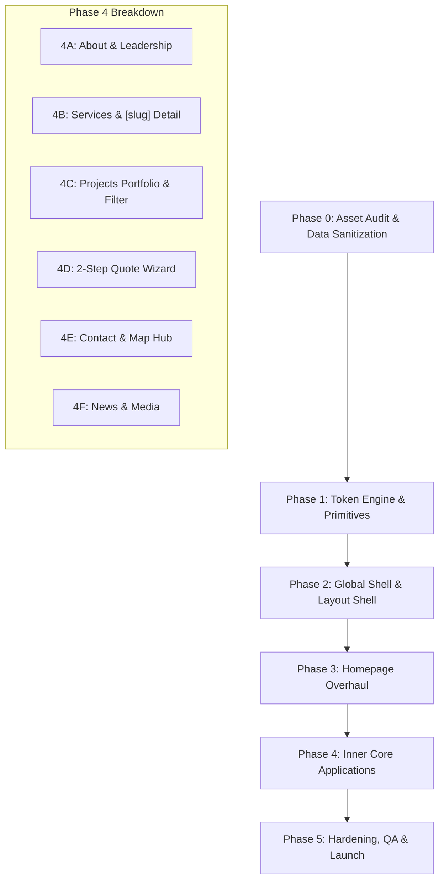

# MICON Web Application — Master UI/UX Redesign Roadmap

> **Authoritative Technical & Design Execution Blueprint**  
> *Target System: Next.js 16 (App Router) | Tailwind CSS v4 | Framer Motion | TypeScript*  
> *Companion Document: [`DESIGN.md`](file:///f:/Web%20Development/Micon/DESIGN.md)*

---

## 1. Executive Summary & Strategic Objectives

The primary objective of this roadmap is to transform **MICON** from a standard brochure-style website into an **enterprise-grade, interactive industrial engineering platform**. 

### Core Engineering & Design Deliverables
1. **100% Theme Cohesion**: Eradicate all hardcoded colors (`bg-white`, `text-black`, `from-white`) to ensure seamless switching between *Architectural Paper (Light)* and *Midnight Steel (Dark)* modes.
2. **Single Source of Truth**: Eliminate conflicting data across pages by centralizing founding year (**2018**), delivered volume (**100+ Turnkey Projects**), and the official head office (**Vatara, Dhaka**).
3. **Zero Dead UI & Broken Links**: Fix 404 image paths (e.g. `/RCC/RCC_2.jpg`), wire active routes to all footer items, connect real social channels, and make every button functional.
4. **Bespoke Architectural Aesthetic**: Implement the *"Living Industrial Blueprint"* visual language defined in [`DESIGN.md`](file:///f:/Web%20Development/Micon/DESIGN.md)—utilizing modular bento grids, hairline coordinates, calibrated monospace telemetry (`JetBrains Mono`), and structural proof cards.
5. **High-Conversion RFP Pipeline**: Upgrade the multi-step quote wizard with visual typology cards, progressive disclosure, and verified confirmation receipts.

---

## 2. Master Execution Phasing



---

## 3. Detailed Phase-by-Phase Implementation Plan

---

### Phase 0: Asset Audit, Media Integrity & Data Sanitization
*Goal: Remove all data conflicts, broken references, and typographic typos before touching the layout.*

| Task ID | Target File | Actions & Implementation Specifics | Verification / Criteria |
| :--- | :--- | :--- | :--- |
| **0.1** | [`lib/data/company.ts`](file:///f:/Web%20Development/Micon/lib/data/company.ts) | • Canonical corporate office (per `COMPANY.md`): `Ka-6/A, 3rd Floor, Jagannathpur, Vatara, Gulshan, Dhaka 1229`.<br>• Official phone: `01844509800` (`+880 1844 509 800`); email `noman@miconbd.com`; website `www.miconbd.com`.<br>• Synchronize corporate social URLs (LinkedIn, Facebook, YouTube). | Single source of truth established. |
| **0.2** | [`lib/data/projects.ts`](file:///f:/Web%20Development/Micon/lib/data/projects.ts) | • **Fix Broken Image**: Replace `/RCC/RCC_2.jpg` in Project id `"4"` with verified asset `/RCC/RCC_1.jpg` (or appropriate public asset).<br>• Validate all project category slugs: `peb-steel`, `rcc`, `green`, `facilities`. | Zero 404 images on project cards. |
| **0.3** | [`lib/data/services.ts`](file:///f:/Web%20Development/Micon/lib/data/services.ts) | • **Fix Broken Image**: Replace `/RCC/RCC_2.jpg` in service id `"retrofitting"` with verified existing asset `/RCC/RCC_1.jpg`.<br>• Audit all 7 services for complete technical specs (code standards, warranties, applications). | All 7 services reference existing imagery. |
| **0.4** | [`components/JsonLd.tsx`](file:///f:/Web%20Development/Micon/components/JsonLd.tsx) | • Synchronize `foundingDate` to `"2018"` (matching hero and about sections).<br>• Ensure all breadcrumb paths match real routes. | Schema.org validation passes cleanly. |

---

### Phase 1: Token Engine, CSS Architecture & UI Primitives
*Goal: Establish absolute styling consistency, calibrate typography, and build reusable UI components.*

| Task ID | Target File | Actions & Implementation Specifics | Verification / Criteria |
| :--- | :--- | :--- | :--- |
| **1.1** | [`app/globals.css`](file:///f:/Web%20Development/Micon/app/globals.css) | • Verify Tailwind CSS v4 `@theme inline` tokens for light (`#F8F9FA`) and dark (`#0F1115`).<br>• Configure standard radius tokens: `--radius-lg: 1rem` (`rounded-2xl` for inner-page cards), `--radius-md: 0.75rem` (`rounded-xl` for sub-containers).<br>• Add blueprint hairline utility classes (inner pages only). No amber glow gradients.<br>• Optimize infinite scroll keyframe speeds and hover-pause behavior. | Light and dark variables fully defined. |
| **1.2** | [`components/ui/button.tsx`](file:///f:/Web%20Development/Micon/components/ui/button.tsx) | • All button sizes and variants use square `rounded-none` geometry.<br>• Eliminate hardcoded text colors; use `bg-primary text-primary-foreground` and `bg-secondary text-secondary-foreground`.<br>• No scale/bounce on hover.<br>• Ensure visible keyboard focus rings (`focus-visible:ring-2 focus-visible:ring-primary`). | Uniform button variants across all sizes. |
| **1.3** | [`components/ui/card.tsx`](file:///f:/Web%20Development/Micon/components/ui/card.tsx) | • Update `Card` container to default to `rounded-2xl border border-border/80 bg-card text-card-foreground shadow-sm`.<br>• Standardize padding scales: `p-6 md:p-8` for outer cards. | Cards elevate seamlessly in dark and light modes. |
| **1.4** | [`components/ui/badge.tsx`](file:///f:/Web%20Development/Micon/components/ui/badge.tsx) | • Standardize all badges to `rounded-full font-heading uppercase tracking-wider text-[11px]`.<br>• Implement semantic variants: `default` (amber), `secondary` (slate), `success` (green), `outline` (hairline). | Crisp monospace badge tags. |
| **1.5** | [`components/ui/input.tsx`](file:///f:/Web%20Development/Micon/components/ui/input.tsx) & [`components/ui/textarea.tsx`](file:///f:/Web%20Development/Micon/components/ui/textarea.tsx) | • Set default radius to `rounded-xl`.<br>• Ensure full dark mode compatibility (`bg-transparent dark:bg-card/40 border-input`).<br>• Add persistent amber focus states (`focus-visible:border-primary focus-visible:ring-1 focus-visible:ring-primary`). | Form controls look polished and accessible. |

---

### Phase 2: Global Shell & Layout Architecture
*Goal: Modernize navigation, universal heroes, and the footer ecosystem.*

| Task ID | Target File | Actions & Implementation Specifics | Verification / Criteria |
| :--- | :--- | :--- | :--- |
| **2.1** | [`components/Navbar.tsx`](file:///f:/Web%20Development/Micon/components/Navbar.tsx) | • Transparent over dark heroes; transitions to `bg-background/95 backdrop-blur-md shadow-xs` on scroll — square and borderless in every state.<br>• Fix dynamic logo switching between `Logo_White.png` and `Logo_Black.png`.<br>• Square amber underline for active/hover links (no sliding pill, no spring).<br>• Square "Contact" CTA; no phone number; "Contact" removed from nav links.<br>• Mobile drawer: square, borderless, backdrop overlay, accessible close action. | Smooth, non-jittery navigation across all devices. |
| **2.2** | [`components/Footer.tsx`](file:///f:/Web%20Development/Micon/components/Footer.tsx) | • **Eradicate Dead Links**: Replace `/safety`, `/privacy`, `/terms`, `/compliance` with real functional destinations or legal dialog modals.<br>• Wire verified social URLs from `COMPANY_CONTACT.social` (replacing dead `#` links).<br>• Add company registration badge, ISO 9001:2015 certification stamp, and direct hotline card.<br>• Ensure full dark mode palette compatibility (no inverted white blocks). | Zero 404 links; authoritative footer presence. |
| **2.3** | [`components/PageHero.tsx`](file:///f:/Web%20Development/Micon/components/PageHero.tsx) | • **Implement Breadcrumbs**: Actually render the `breadcrumbs` array with Chevron separators and Schema.org markup.<br>• Add subtle architectural blueprint grid overlay (`bg-[size:32px_32px]` hairline lines).<br>• Render the kicker as plain uppercase amber text (no `//`, no pill) and a dual-font headline (Sora + Fraunces italic). | Functional breadcrumbs and consistent visual impact. |
| **2.4** | [`components/SectionTitle.tsx`](file:///f:/Web%20Development/Micon/components/SectionTitle.tsx) | • Plain uppercase amber kicker (e.g. `ENGINEERING DISCIPLINES`) — no `//` coordinates, no pill.<br>• Sora title with Fraunces italic amber highlight; no description paragraph.<br>• Square accent rule (bar + square tick).<br>• Provide clean alignment options (`left` or `center`). | Visual consistency across all page section headers. |

---

### Phase 3: Homepage Overhaul (`app/page.tsx`)
*Goal: Re-engineer the home page to immediately communicate engineering authority, technical scale, and conversion pathways.*

| Section / Component | Target File | Redesign Architecture & Key Upgrades |
| :--- | :--- | :--- |
| **3.1 Hero** | [`sections/home/Hero.tsx`](file:///f:/Web%20Development/Micon/sections/home/Hero.tsx) | • Fullscreen viewport height with industrial background and dark contrast overlay (no radial spotlight).<br>• Headline leads straight into CTAs — no description paragraph.<br>• Telemetry strip: `60M+ CLEAR SPAN` • `5,000 MT/MO FABRICATION` • `ISO 9001:2015` • `ZERO INCIDENT HSE`.<br>• Clean up dead imports (`swiper/css`, unused `certifications` constant).<br>• Dual square action buttons: "Inspect Project Portfolio" and "Engineering Capabilities" (no shimmer). |
| **3.2 Accreditations** | [`sections/home/Certifications.tsx`](file:///f:/Web%20Development/Micon/sections/home/Certifications.tsx) | • Infinite horizontal marquee showcasing regulatory authority licenses (PWD A-Class, BEPZA, DGFI MES Clearance, ISO 9001:2015, DoE).<br>• Square, borderless tonal tiles with pause-on-hover interaction (no glow). |
| **3.3 Bento Disciplines** | [`sections/home/Expertise.tsx`](file:///f:/Web%20Development/Micon/sections/home/Expertise.tsx) | • Replace basic 3-card row with a **Modular Bento Grid**: Large featured module for *PEB Steel Buildings* (emphasizing 60m+ clear spans), paired with balanced modules for *Turnkey RCC*, *Treatment Facilities*, and *BIM Modeling*.<br>• Each card features engineering spec pills, delivery speed comparison, and direct slug routing. |
| **3.4 Live Metric Stats** | [`sections/home/Stats.tsx`](file:///f:/Web%20Development/Micon/sections/home/Stats.tsx) | • Refined animated spring counters: `100+ Turnkey Projects Delivered`, `30+ Industry Structural Engineers`, `7+ Years Established`, `5,000 MT Monthly Capacity`.<br>• Divided by subtle vertical blueprint hairlines with monospace values. |
| **3.5 Design-Build Process** | [`sections/home/DesignBuildProcess.tsx`](file:///f:/Web%20Development/Micon/sections/home/DesignBuildProcess.tsx) | • Interactive 5-phase execution flow (*01 BIM 3D Modeling -> 02 Factory Fabrication -> 03 Civil Foundation -> 04 On-Site Assembly -> 05 Turnkey Handover*).<br>• Visual step selector pills with synchronized specification checklist and animated deliverables diagram. |
| **3.6 Machinery Fleet** | [`sections/home/MachineryFleet.tsx`](file:///f:/Web%20Development/Micon/sections/home/MachineryFleet.tsx) | • Presentation of owned physical capital (CNC beam lines, 50-100 ton cranes, 60 m³/hr concrete batching, laser total stations).<br>• High-contrast cards detailing monthly output capacities and tolerance ratings. |
| **3.7 Project Showcase** | [`sections/home/FeaturedProjects.tsx`](file:///f:/Web%20Development/Micon/sections/home/FeaturedProjects.tsx) | • **Flagship Dossier Bento** (replaced the earlier split-screen slider): dominant CREC Padma Rail Link card (col 7) + stacked TVS Autos and Flaxen LEED cards (col 5), using real `COMPANY.md` projects.<br>• Bottom authority strip (100+ projects, accreditations, archive CTA) and engineering review modal.<br>• Square and borderless. |
| **3.8 Strategic Partners** | [`sections/home/Partners.tsx`](file:///f:/Web%20Development/Micon/sections/home/Partners.tsx) | • **Fix Dark Mode Bug**: Remove hardcoded `bg-white` and `from-white`; replace with semantic `bg-background` and `from-background`.<br>• Seamless infinite scroll displaying RAK, TVS, LafargeHolcim, Bata, Energypac, Anfords, CREC with grayscale-to-color hover transitions. |
| **3.9 Enterprise CTA** | [`sections/home/CTA.tsx`](file:///f:/Web%20Development/Micon/sections/home/CTA.tsx) & [`components/CTASection.tsx`](file:///f:/Web%20Development/Micon/components/CTASection.tsx) | • High-contrast architectural dock featuring direct proposal request button, 24/7 hotline telephone badge, and senior engineering consultation contact. |

---

### Phase 4: Core Sub-Pages Redesign

#### 4A: About Us & Corporate Profile (`app/about/page.tsx`) — COMPLETED (Oct 3, 2026)
- [x] **Hero Section ([`sections/about/Hero.tsx`](file:///f:/Web%20Development/Micon/sections/about/Hero.tsx))**: Connected PageHero with functional breadcrumbs, clean kicker (`CORPORATE PROFILE`), dual-font title (`Engineering Beyond Foundations`), executive description, and square CTAs (`Our Capabilities` -> `/services`, `Contact Team` -> `/contact`).
- [x] **Executive Leadership ([`sections/about/Leader.tsx`](file:///f:/Web%20Development/Micon/sections/about/Leader.tsx))**: Modernized Managing Director **Engr. Md. Noman Or Rashid** profile (M.Sc. Civil Engineering, BUET; 15+ years experience per `COMPANY.md`) with grayscale/warm portrait, authentic pilgrimage founder's vision quote, MES (DGFI Cleared) / PWD Class-A telemetry, and full Senior Executive Governance table (90+ yrs collective experience).
- [x] **Mission & Vision ([`sections/about/MissionVision.tsx`](file:///f:/Web%20Development/Micon/sections/about/MissionVision.tsx))**: Dual blueprint cards incorporating corporate motto `"BUILDING BEYOND"`, single-source design-build accountability, BIM 3D precision, and LEED/EDGE sustainability horizons.
- [x] **Machinery Inventory ([`sections/about/Machinaries.tsx`](file:///f:/Web%20Development/Micon/sections/about/Machinaries.tsx))**:
  - **Typo & Nomenclature Fixes**: Fixed `"Poops"` -> `"Formwork Props (5,000 NOS)"`, `"Roof Woost"` -> `"Roof Hoist (02 NOS)"`, renamed section label to `"Machinery & Capital Equipment"`.
  - **Theme & UI Modernization**: Replaced hardcoded `bg-white` and gradients with semantic `bg-card` and `bg-background`; square cards and buttons; added interactive search-filtered asset dossier modal.
- [x] **Technical Capacity ([`sections/about/TechnicalCapacity.tsx`](file:///f:/Web%20Development/Micon/sections/about/TechnicalCapacity.tsx))**: Replaced placeholder cards with 4 authentic disciplines linked to actual service routes (`/services/peb-steel`, `/services/turnkey-construction`, `/services/treatment-plants`, `/services/structural-retrofitting`), plus 30+ certified industry expert breakdown matrix from `COMPANY.md`.
- [x] **Core Values ([`sections/about/CoreValues.tsx`](file:///f:/Web%20Development/Micon/sections/about/CoreValues.tsx))**: Fixed inverted `bg-white` theme bug; implemented 5 authentic corporate pillars from `COMPANY.md` (Precision, Punctual Delivery, Safety & Rigor, Human Dignity, Environmental Responsibility) with `01`-`05` mono indices (no `//`) and square geometry.
- [x] **Sustainability & ESG ([`sections/about/Sustainability.tsx`](file:///f:/Web%20Development/Micon/sections/about/Sustainability.tsx))**: 6 EPC green practices directly aligned with `COMPANY.md` (Sustainable BIM Design, Smart Eco-Procurement, Off-Site Zero-Waste Prefabrication, Energy Conservation, Water Recycling & ZLD, DoE & ISO 14001 Compliance) with square telemetry tiles and no emojis.
- [x] **Corporate CTA ([`sections/about/CTA.tsx`](file:///f:/Web%20Development/Micon/sections/about/CTA.tsx))**: Integrated `BUILDING BEYOND` framing with dark variant and full contact dock displaying canonical phone, email, and Vatara office address.
- [x] **Metadata & SEO ([`app/about/page.tsx`](file:///f:/Web%20Development/Micon/app/about/page.tsx))**: Updated metadata with BUET civil engineering leadership, PWD Class-A credentials, and OpenGraph descriptors.

#### 4B: Services Engine & Dynamic SSG Detail Pages (`app/services/*`) — COMPLETED (Oct 7, 2026)
- [x] **Catalog Overview ([`app/services/page.tsx`](file:///f:/Web%20Development/Micon/app/services/page.tsx))**: Hero (corrupted-encoding description fixed) -> `ServicesList` (7 square `ServiceCard`s) -> `Standards` (credentials from `COMPANY.md`: ISO 9001:2015, PWD Class-A, MES, BEPZA, BEZA, LGED) -> `ProcessFlow` (Design, Procurement, Construction, Handover) -> CTA.
- [x] **Dynamic Service Detail Page ([`app/services/[slug]/page.tsx`](file:///f:/Web%20Development/Micon/app/services/%5Bslug%5D/page.tsx))**:
  - Pre-rendered via `generateStaticParams()` with dynamic OpenGraph metadata and canonical URL.
  - `PageHero` with breadcrumbs `Home / Services / {tag}` (BreadcrumbList JSON-LD).
  - Overview, applications and verifiable specification matrix with standards.
  - Numbered key advantages, executed-projects table (real `COMPANY.md` clients and areas), other services, contextual CTA.
- [x] **Data Integrity ([`lib/data/services.ts`](file:///f:/Web%20Development/Micon/lib/data/services.ts), [`types/service.ts`](file:///f:/Web%20Development/Micon/types/service.ts))**: Removed all unverifiable claims (warranties, timelines, erection speeds, clear spans, capacities, OHSAS 18001). Added `references` per service. Boundary Walls, Retrofitting, Utility Infrastructure and BIM re-scoped to what `COMPANY.md` states.
- [x] **Cross-link fix**: About > Technical Capacity pointed at the non-existent `/services/etp-wtp-stp`; corrected to `/services/treatment-plants`.

#### 4C: Projects Portfolio & Interactive Gallery (`app/projects/page.tsx`) — COMPLETED (Oct 7, 2026)
- [x] **Canonical Portfolio Data ([`lib/data/projects.ts`](file:///f:/Web%20Development/Micon/lib/data/projects.ts), [`types/project.ts`](file:///f:/Web%20Development/Micon/types/project.ts))**: Overhauled all 12 projects to match `COMPANY.md` contracted clients (CREC, TVS Autos, Flaxen Dress Maker, Energypac/PGCB, Eurotex Spinning Mills, SM Knitwear, Focus Auto Bricks, Bay Tannery, SM Accessories, Oscar Bangla, Lax Lingerie, Saiham Knit Composite); eliminated placeholder clients; added `retrofitting` category.
- [x] **Search & Category Engine ([`sections/projects/ProjectsClient.tsx`](file:///f:/Web%20Development/Micon/sections/projects/ProjectsClient.tsx))**:
  - Live query search across title, client, location, tags, description, and deliverables.
  - Sticky square category selector bar (*All Projects, PEB Steel Buildings, Turnkey RCC, Green Factories, Utility & Treatment, Retrofitting*) with dynamic count badges.
  - URL hash support for deep linking directly to project blueprint modals.
- [x] **Project Card Modernization ([`components/ProjectCard.tsx`](file:///f:/Web%20Development/Micon/components/ProjectCard.tsx))**:
  - Crisp square geometry (`rounded-none`), tonal surface (`bg-card`), smooth hover scale.
  - Monospace telemetry metadata strip (Location, Area, Year) and status stamp (`COMPLETED`).
  - Interactive "Inspect Blueprint" action that triggers the technical dossier modal.
- [x] **Architectural Blueprint Detail Modal**:
  - Technical blueprint dialog displaying hero image with location & area overlay, engineering scope narrative, key technical deliverables grid, technical tags, and direct CTA to request proposal.
  - Zero emojis (removed legacy `📍` and typos).
- [x] **Server Component Page Shell ([`app/projects/page.tsx`](file:///f:/Web%20Development/Micon/app/projects/page.tsx))**: Converted page to Server Component exporting complete SEO `Metadata`, canonical tags, and OpenGraph descriptors.

#### 4D: 2-Step Quote Proposal Wizard (`app/quote/page.tsx`)
- [ ] **Page Shell**: Static server wrapper exporting SEO metadata, with client-side form and sidebar.
- [ ] **Contact Sidebar ([`sections/quote/ContactSidebar.tsx`](file:///f:/Web%20Development/Micon/sections/quote/ContactSidebar.tsx))**:
  - **Data Fix**: Replace the hardcoded Bashundhara address with canonical Vatara head office.
  - **Phone Fix**: Replace placeholder `+880 1234-567890` with the official number `+880 1844 509 800` (from `COMPANY_CONTACT`).
  - **Theme Fix**: Replace hardcoded `bg-white` with `bg-card`.
- [ ] **Multi-Step Form ([`sections/quote/QuoteForm.tsx`](file:///f:/Web%20Development/Micon/sections/quote/QuoteForm.tsx))**:
  - **Step 1**: Bento card selectors for project typology (*PEB Steel*, *Turnkey RCC*, *ETP/WTP*, *Green Factory*), square footage input with `sq. ft` suffix, and district location.
  - **Step 2**: Enterprise BDT budget brackets, completion windows, and regulatory compliance requirements (LEED Gold, DoE, Accord/Alliance).
  - **Submission State**: Branded tracking reference ID generation (e.g. `MICON-RFP-8924`) with feedback toast and senior director direct contact button.

#### 4E: Contact & Engineering Directory (`app/contact/page.tsx`) — COMPLETED (Oct 7, 2026)
- [x] **Directory Cards ([`sections/contact/ContactClient.tsx`](file:///f:/Web%20Development/Micon/sections/contact/ContactClient.tsx))**: Tonal square cards detailing Corporate Headquarters (Vatara, Gulshan), Communications Matrix (official phone `+880 1844 509 800`, email `noman@miconbd.com`, website `miconbd.com`), and Operating Schedule (Sunday - Thursday 9AM - 7PM).
- [x] **Side-by-Side Inquiry Form & Interactive Google Map Row**: Placed the 5-field Direct Inquiry Form (`lg:col-span-6`, square inputs `rounded-none`, phone callback collection, toast feedback) and the Interactive Google Map (`lg:col-span-6`, Vatara office coordinates, architectural header bar, direct external navigation link) side-by-side in a single equal-height row (`lg:grid-cols-12 items-stretch`). Removed redundant Executive Leadership, Licensed Enterprise Credentials, and Corporate Networks cards to keep the layout focused and clean.
- [x] **FAQ Accordion & UI Modernization ([`components/ui/accordion.tsx`](file:///f:/Web%20Development/Micon/components/ui/accordion.tsx))**: Modernized to square geometry (`rounded-none`), answering key questions on PEB timelines, LEED green factories, turnkey RCC, and safety protocols.
- [x] **Server Component Page Shell ([`app/contact/page.tsx`](file:///f:/Web%20Development/Micon/app/contact/page.tsx))**: Exporting complete SEO `Metadata`, canonical URL, and OpenGraph tags.

#### 4F: News & Media Insights (`app/news/page.tsx`)
- [ ] **Article Cards**: Project milestone updates, ISO recertification news, and BIM engineering technical insights.
- [ ] **Article Modals**: Add modal reading drawer for each article to provide complete reading experience without broken anchor tags.

---

### Phase 5: Verification, Quality Assurance & Performance Hardening
*Goal: Ensure 100% type safety, zero console errors, full responsive stability, and accessible compliance.*

| QA Gate | Tool / Command | Verification Criteria |
| :--- | :--- | :--- |
| **5.1 Type Safety** | `npx tsc --noEmit` | **0 errors**. Strict TypeScript compilation across all routes and components. |
| **5.2 Linting & Standards**| `npm run lint` | **0 warnings / 0 errors**. Next.js ESLint compliance. |
| **5.3 Responsive Matrix** | Chrome DevTools / Viewports | Verified at `375px` (Mobile), `768px` (Tablet), `1024px` (Laptop), `1440px` (Desktop). |
| **5.4 Theme Integrity** | Theme Toggle (`.dark`) | Verified 0 instances of unreadable dark-on-dark or harsh white-on-dark blocks. |
| **5.5 Link & Route Audit** | Custom crawl | Verified 0 broken 404 links across all navigation, footer, and cards. |
| **5.6 Media Audit** | Network tab inspection | Verified 0 missing 404 images across all sections and routes. |

---

## 4. Execution Order & Dependencies

```
[Phase 0: Data & Assets]
        │
        ▼
[Phase 1: Token Engine & Primitives]
        │
        ▼
[Phase 2: Global Shell (Navbar/Footer/Hero)]
        │
        ▼
[Phase 3: Homepage Overhaul]
        │
        ├──────────────────┬──────────────────┬──────────────────┐
        ▼                  ▼                  ▼                  ▼
 [Phase 4A: About]  [Phase 4B: Services] [Phase 4C: Projects] [Phase 4D: Quote]
        │                  │                  │                  │
        └──────────────────┴─────────┬────────┴──────────────────┘
                                     │
                                     ▼
                            [Phase 4E: Contact & News]
                                     │
                                     ▼
                            [Phase 5: Final QA & Audit]
```

---

## 5. Risk Assessment & Mitigation Strategies

| Risk | Potential Impact | Mitigation Strategy |
| :--- | :--- | :--- |
| **Tailwind CSS v4 Token Compatibility** | Custom CSS variables breaking with `@theme inline` | Use strict `@theme inline` mapping in [`app/globals.css`](file:///f:/Web%20Development/Micon/app/globals.css) and verify all color variables compile correctly. |
| **Missing Image 404s** | Broken visual experience on project & service detail | Point all image paths to verified existing assets in `public/` and provide graceful Next.js image fallbacks. |
| **Mobile Drawer Body Scroll Lock** | Unscrollable page after closing drawer | Clean up `useEffect` scroll locks properly in [`components/Navbar.tsx`](file:///f:/Web%20Development/Micon/components/Navbar.tsx) on route changes. |
| **Dynamic SSG Build Failure** | Build breaks on `/services/[slug]` | Ensure all `slug` entries in [`lib/data/services.ts`](file:///f:/Web%20Development/Micon/lib/data/services.ts) match `generateStaticParams()` data exactly. |
| **Dark Theme Contrast Bugs** | Unreadable text on cards | Eliminate all instances of hardcoded `bg-white` and use `bg-card text-card-foreground` exclusively. |
